# Solver benchmark campaign, November 2026 (SCS 3.3.2)

Clarabel, CVXOPT, cuOpt, HiGHS, OSQP, PDLP (OR-Tools), PIQP, ProxQP, SCS 3.3.2 and SDPA on standard QP, LP, SDP and infeasible test sets, run on Modal. Every solver ran on the same hardware: the CPU solvers in 4-core containers on AMD EPYC Zen 3 (Milan) hosts, the GPU solvers (SCS with cuDSS, cuOpt) on an NVIDIA A100-SXM4-80GB with an AMD EPYC Zen 3 host; containers on other hardware handed their jobs back, and each container's CPU, GPU and solver versions are recorded with its rows. Every solve is re-verified from the problem data at ten times the plot's target tolerance, so a "solve" below means a verified solution, whatever the solver reported. Failures are charged three times the time limit in the shifted geometric means (shift 10 s); a solve finishing after the limit plus 60 s counts as a failure. Because a requested tolerance means different things to different solvers, each plot shows every solver from the run whose achieved accuracy matches the plot's target: SCS, OSQP and cuOpt from the run at the nominal tolerance, PDLP and ProxQP from one decade tighter, and the interior-point solvers Clarabel, PIQP, HiGHS, SDPA and CVXOPT from their 1e-6 runs (Clarabel 1e-8 on SDP). See [MANIFEST.md](MANIFEST.md) for versions, hardware and the full rules; the September 2026 campaign (SCS 3.3.1, Modal hosts not controlled or recorded per container) is in [`../scs33_2026-09`](../scs33_2026-09).

Table cells read *verified solves / problems · shifted geometric mean time*. "Largest quartile" is the quarter of the family with the most nonzeros. Raw rows for every solver, tolerance and problem are in [`merged/`](merged/) and per-problem status and times in [`per_problem/`](per_problem/).

## Headline

Largest quarter of the QP and LP sets and the Mittelmann LP set, at 1e-4 (top) and 1e-5 (bottom):

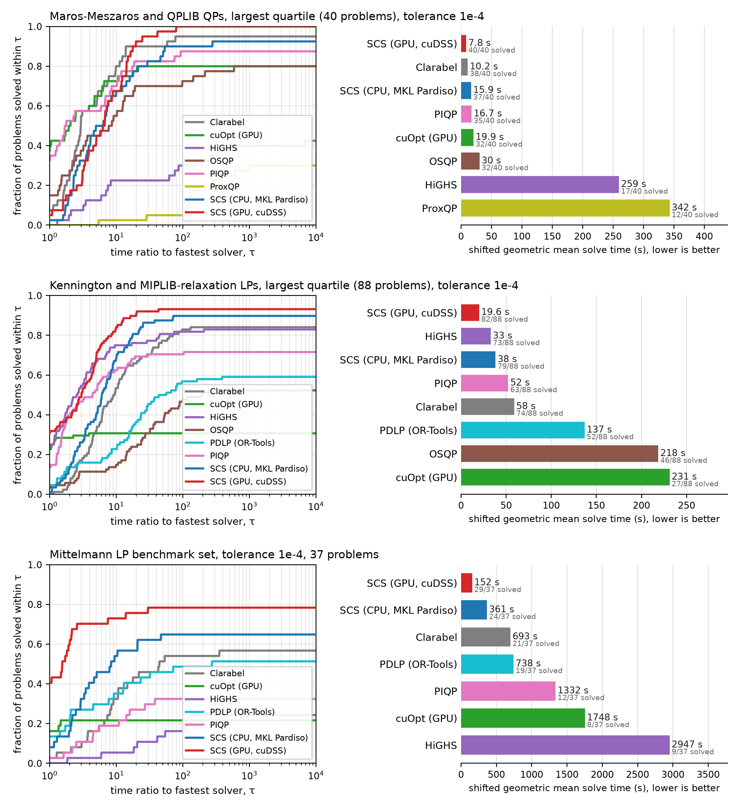

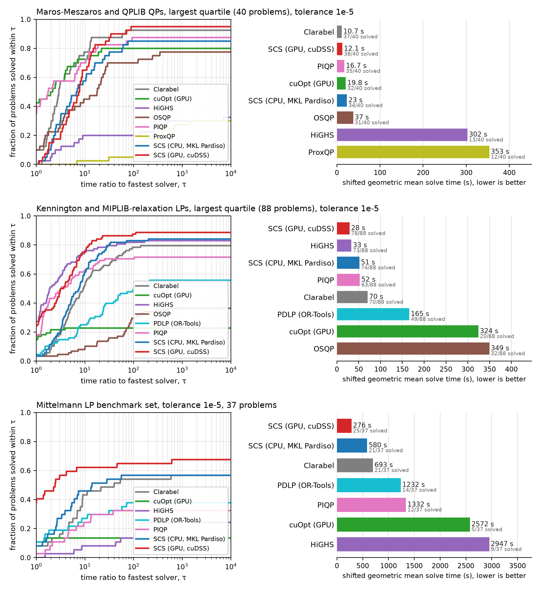

## Quadratic programs

Maros-Meszaros (138) and QPLIB continuous convex (19): 157 problems, 300 s limit.

| Solver | 1e-4, all | 1e-4, largest quartile | 1e-5, all | 1e-5, largest quartile | 1e-6, all | 1e-6, largest quartile |
|---|---|---|---|---|---|---|
| Clarabel | 153/157 · 2.7 s | 38/40 · 10.2 s | 152/157 · 2.8 s | 37/40 · 10.7 s | 148/157 · 4.1 s | 34/40 · 17.2 s |
| PIQP | 151/157 · 3.5 s | 35/40 · 16.7 s | 151/157 · 3.5 s | 35/40 · 16.7 s | 151/157 · 3.5 s | 35/40 · 16.7 s |
| SCS (GPU, cuDSS) | 148/157 · 6.3 s | 40/40 · 7.8 s | 146/157 · 7.5 s | 38/40 · 12.1 s | 141/157 · 10.5 s | 34/40 · 21.2 s |
| SCS (CPU, MKL Pardiso) | 144/157 · 7.7 s | 37/40 · 15.9 s | 142/157 · 8.4 s | 34/40 · 22.5 s | 141/157 · 9.5 s | 33/40 · 23.5 s |
| OSQP | 138/157 · 10.9 s | 32/40 · 29.6 s | 131/157 · 16.1 s | 31/40 · 37.1 s | 121/157 · 27.8 s | 30/40 · 42.6 s |
| cuOpt (GPU) | 109/157 · 32.8 s | 32/40 · 19.9 s | 109/157 · 32.8 s | 32/40 · 19.8 s | 104/157 · 38.0 s | 28/40 · 32.2 s |
| HiGHS | 107/157 · 47.0 s | 17/40 · 258.9 s | 97/157 · 57.8 s | 13/40 · 302.0 s | 84/157 · 81.5 s | 10/40 · 355.9 s |
| ProxQP | 94/157 · 73.5 s | 12/40 · 342.2 s | 90/157 · 73.6 s | 12/40 · 352.9 s | 83/157 · 92.0 s | 12/40 · 352.9 s |

1e-4, all problems:

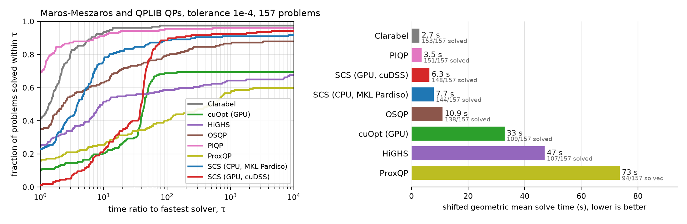

1e-4, largest quartile:

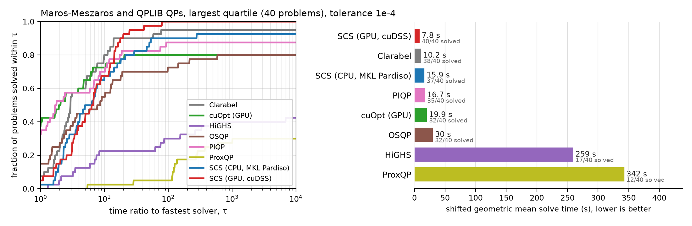

1e-5, all problems:

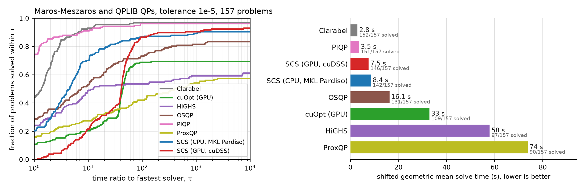

1e-5, largest quartile:

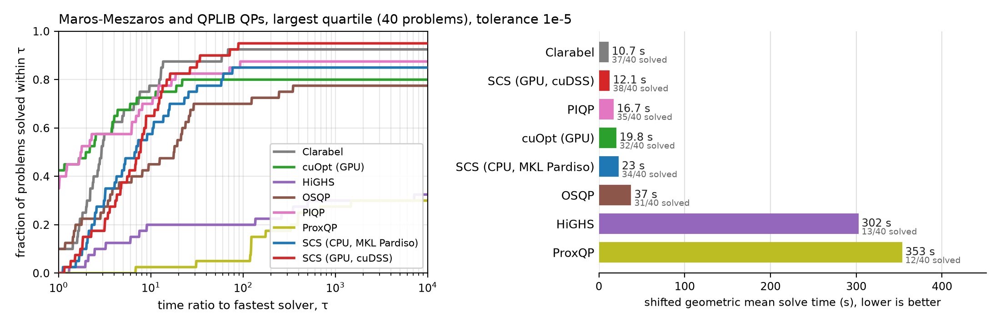

1e-6, all problems:

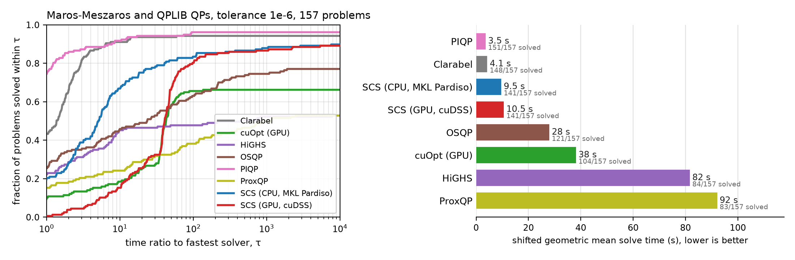

1e-6, largest quartile:

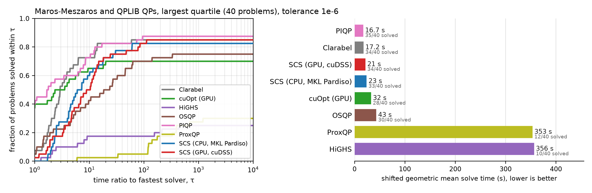

By data set at 1e-4:

| Solver | Maros-Meszaros | QPLIB |
|---|---|---|
| Clarabel | 136/138 · 1.1 s | 17/19 · 23.7 s |
| SCS (GPU, cuDSS) | 130/138 · 4.9 s | 18/19 · 21.4 s |
| SCS (CPU, MKL Pardiso) | 128/138 · 5.4 s | 16/19 · 39.0 s |
| PIQP | 138/138 · 0.7 s | 13/19 · 61.9 s |
| cuOpt (GPU) | 96/138 · 31.3 s | 13/19 · 45.1 s |
| OSQP | 126/138 · 7.4 s | 12/19 · 69.4 s |
| HiGHS | 100/138 · 34.0 s | 7/19 · 361.6 s |
| ProxQP | 91/138 · 54.1 s | 3/19 · 555.5 s |

By data set at 1e-6:

| Solver | Maros-Meszaros | QPLIB |
|---|---|---|
| Clarabel | 134/138 · 1.8 s | 14/19 · 40.7 s |
| PIQP | 138/138 · 0.7 s | 13/19 · 61.9 s |
| SCS (GPU, cuDSS) | 128/138 · 7.2 s | 13/19 · 61.3 s |
| SCS (CPU, MKL Pardiso) | 129/138 · 6.0 s | 12/19 · 72.0 s |
| OSQP | 110/138 · 23.0 s | 11/19 · 92.7 s |
| cuOpt (GPU) | 94/138 · 33.9 s | 10/19 · 82.3 s |
| HiGHS | 81/138 · 62.4 s | 3/19 · 491.1 s |
| ProxQP | 80/138 · 70.3 s | 3/19 · 569.9 s |

## Linear programs

Netlib (93), Kennington (16) and the 240 MIPLIB 2017 benchmark relaxations: 349 problems, 300 s limit.

| Solver | 1e-4, all | 1e-4, largest quartile | 1e-5, all | 1e-5, largest quartile | 1e-6, all | 1e-6, largest quartile |
|---|---|---|---|---|---|---|
| HiGHS | 333/349 · 5.6 s | 73/88 · 32.6 s | 333/349 · 5.6 s | 73/88 · 32.6 s | 333/349 · 5.6 s | 73/88 · 32.6 s |
| SCS (GPU, cuDSS) | 334/349 · 6.3 s | 82/88 · 19.6 s | 327/349 · 8.9 s | 78/88 · 28.3 s | 318/349 · 12.3 s | 76/88 · 36.5 s |
| SCS (CPU, MKL Pardiso) | 330/349 · 8.4 s | 79/88 · 37.7 s | 321/349 · 11.3 s | 74/88 · 50.9 s | 313/349 · 14.4 s | 68/88 · 65.7 s |
| Clarabel | 330/349 · 8.9 s | 74/88 · 58.4 s | 322/349 · 10.7 s | 70/88 · 69.6 s | 316/349 · 12.0 s | 68/88 · 73.2 s |
| PIQP | 317/349 · 9.4 s | 63/88 · 51.8 s | 315/349 · 9.8 s | 63/88 · 51.8 s | 311/349 · 10.7 s | 63/88 · 51.8 s |
| PDLP (OR-Tools) | 291/349 · 24.6 s | 52/88 · 136.6 s | 283/349 · 30.4 s | 49/88 · 165.2 s | 262/349 · 38.9 s | 40/88 · 222.4 s |
| cuOpt (GPU) | 230/349 · 38.7 s | 27/88 · 230.7 s | 216/349 · 47.6 s | 20/88 · 323.7 s | 207/349 · 54.7 s | 18/88 · 358.6 s |
| OSQP | 258/349 · 42.5 s | 46/88 · 218.1 s | 217/349 · 74.3 s | 32/88 · 348.6 s | 173/349 · 132.0 s | 20/88 · 469.0 s |

1e-4, all problems:

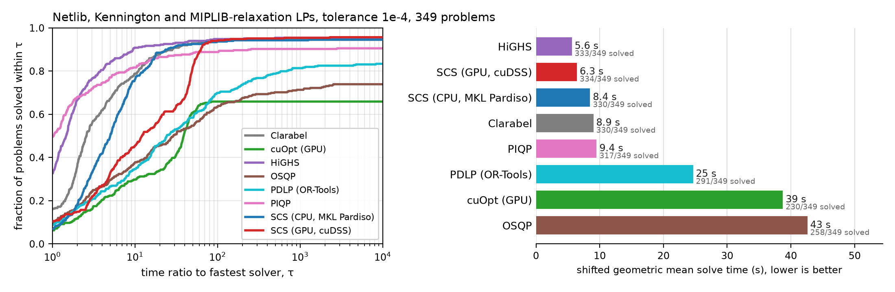

1e-4, largest quartile:

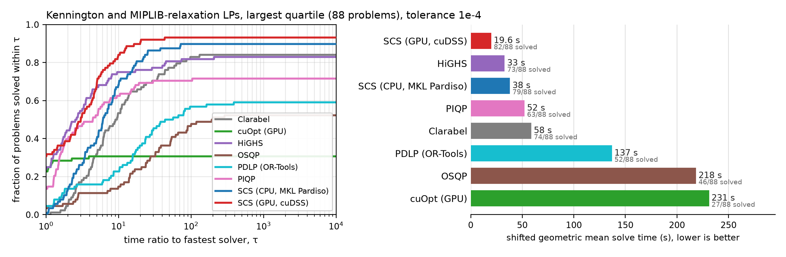

1e-5, all problems:

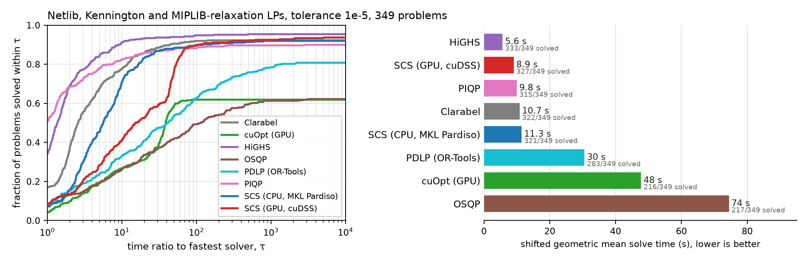

1e-5, largest quartile:

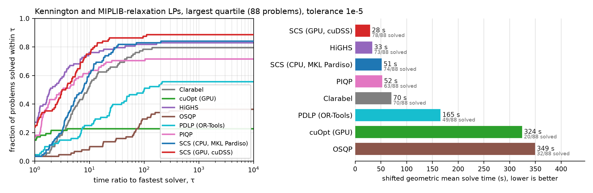

1e-6, all problems:

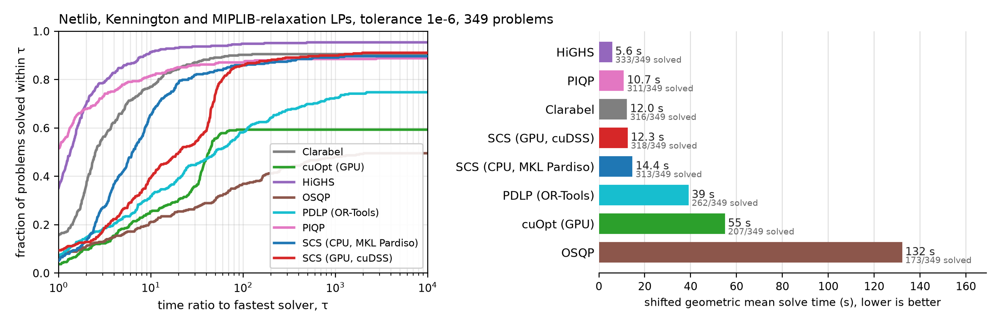

1e-6, largest quartile:

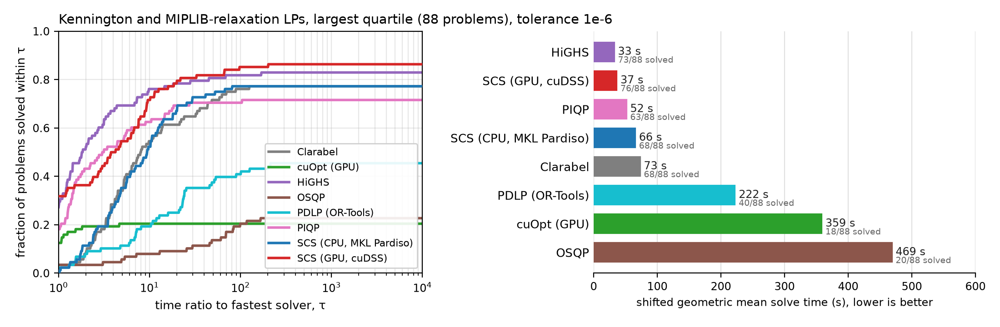

By data set at 1e-4:

| Solver | Kennington | MIPLIB 2017 relaxations | Netlib |
|---|---|---|---|
| HiGHS | 16/16 · 1.7 s | 224/240 · 8.7 s | 93/93 · 0.2 s |
| PIQP | 16/16 · 5.3 s | 210/240 · 13.6 s | 91/93 · 2.3 s |
| SCS (GPU, cuDSS) | 15/16 · 14.2 s | 230/240 · 7.3 s | 89/93 · 3.2 s |
| SCS (CPU, MKL Pardiso) | 16/16 · 11.9 s | 226/240 · 10.7 s | 88/93 · 3.2 s |
| Clarabel | 15/16 · 12.7 s | 224/240 · 12.9 s | 91/93 · 1.3 s |
| PDLP (OR-Tools) | 15/16 · 22.3 s | 187/240 · 35.1 s | 89/93 · 7.6 s |
| OSQP | 11/16 · 76.2 s | 174/240 · 49.8 s | 73/93 · 24.4 s |
| cuOpt (GPU) | 7/16 · 119.7 s | 137/240 · 62.6 s | 86/93 · 4.7 s |

By data set at 1e-6:

| Solver | Kennington | MIPLIB 2017 relaxations | Netlib |
|---|---|---|---|
| HiGHS | 16/16 · 1.7 s | 224/240 · 8.7 s | 93/93 · 0.2 s |
| PIQP | 16/16 · 5.3 s | 204/240 · 15.8 s | 91/93 · 2.3 s |
| Clarabel | 15/16 · 12.7 s | 212/240 · 17.4 s | 89/93 · 2.4 s |
| SCS (GPU, cuDSS) | 13/16 · 40.0 s | 222/240 · 12.7 s | 83/93 · 8.7 s |
| SCS (CPU, MKL Pardiso) | 14/16 · 41.6 s | 215/240 · 16.8 s | 84/93 · 6.9 s |
| cuOpt (GPU) | 8/16 · 88.1 s | 116/240 · 95.8 s | 83/93 · 6.9 s |
| PDLP (OR-Tools) | 9/16 · 142.9 s | 170/240 · 50.3 s | 83/93 · 13.4 s |
| OSQP | 9/16 · 148.0 s | 125/240 · 120.6 s | 39/93 · 163.0 s |

## Large linear programs: the Mittelmann set

Hans Mittelmann's LP benchmark set: 37 problems, 1800 s limit, 64 GB containers. PIQP and HiGHS ran at 1e-4 only on this family (as in September) and are shown from that run.

| Solver | 1e-4, all | 1e-4, largest quartile | 1e-5, all | 1e-5, largest quartile |
|---|---|---|---|---|
| SCS (GPU, cuDSS) | 29/37 · 151.9 s | 4/10 · 1388.5 s | 25/37 · 276.4 s | 3/10 · 1656.8 s |
| SCS (CPU, MKL Pardiso) | 24/37 · 361.1 s | 2/10 · 3105.8 s | 21/37 · 579.7 s | 2/10 · 3425.7 s |
| Clarabel | 21/37 · 693.1 s | 2/10 · 3454.1 s | 21/37 · 693.1 s | 2/10 · 3454.1 s |
| PDLP (OR-Tools) | 19/37 · 737.8 s | 1/10 · 4770.6 s | 14/37 · 1231.7 s | 1/10 · 4770.6 s |
| PIQP | 12/37 · 1332.3 s | 1/10 · 3823.1 s | 12/37 · 1332.3 s | 1/10 · 3823.1 s |
| cuOpt (GPU) | 8/37 · 1748.4 s | 1/10 · 2966.0 s | 5/37 · 2572.0 s | 1/10 · 2932.2 s |
| HiGHS | 9/37 · 2947.2 s | 1/10 · 3459.5 s | 9/37 · 2947.2 s | 1/10 · 3459.5 s |

1e-4, all problems:

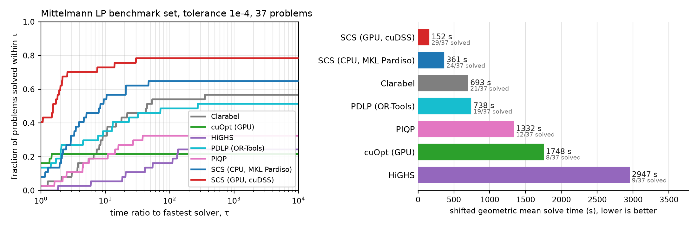

1e-4, largest quartile:

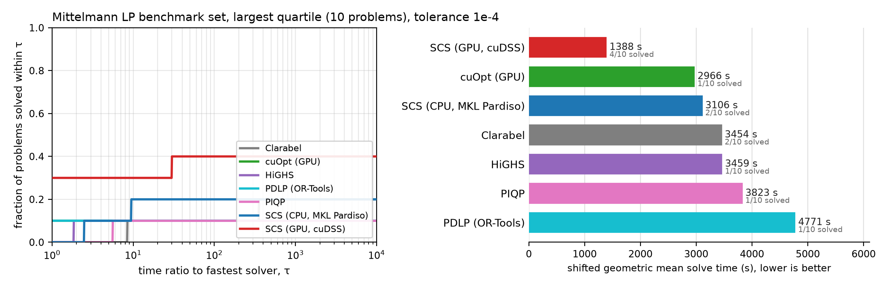

1e-5, all problems:

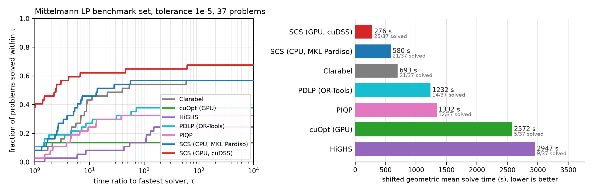

1e-5, largest quartile:

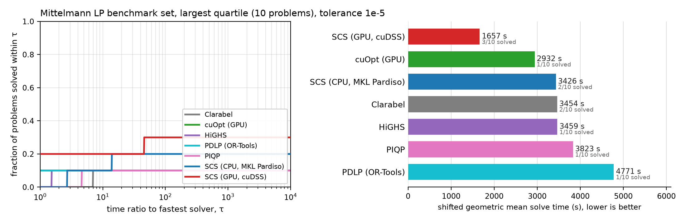

By data set at 1e-4:

| Solver | Mittelmann |
|---|---|
| SCS (GPU, cuDSS) | 29/37 · 151.9 s |
| SCS (CPU, MKL Pardiso) | 24/37 · 361.1 s |
| Clarabel | 21/37 · 693.1 s |
| PDLP (OR-Tools) | 19/37 · 737.8 s |
| PIQP | 12/37 · 1332.3 s |
| cuOpt (GPU) | 8/37 · 1748.4 s |
| HiGHS | 9/37 · 2947.2 s |

## Semidefinite programs

SDPLIB (88 feasible instances) and the Mittelmann SDPs (6): 94 problems, 900 s limit.

| Solver | 1e-4, all | 1e-4, largest quartile | 1e-6, all | 1e-6, largest quartile |
|---|---|---|---|---|
| SDPA | 75/94 · 34.7 s | 20/24 · 45.5 s | 68/94 · 57.6 s | 20/24 · 45.5 s |
| CVXOPT | 76/94 · 46.6 s | 19/24 · 86.9 s | 62/94 · 118.9 s | 17/24 · 139.4 s |
| Clarabel | 71/94 · 63.2 s | 12/24 · 283.7 s | 69/94 · 69.7 s | 11/24 · 313.6 s |
| SCS (CPU, MKL Pardiso) | 83/94 · 63.8 s | 19/24 · 404.5 s | 58/94 · 199.6 s | 10/24 · 1326.8 s |
| SCS (GPU, cuDSS) | 83/94 · 83.5 s | 18/24 · 624.8 s | 54/94 · 270.8 s | 6/24 · 1981.9 s |

1e-4, all problems:

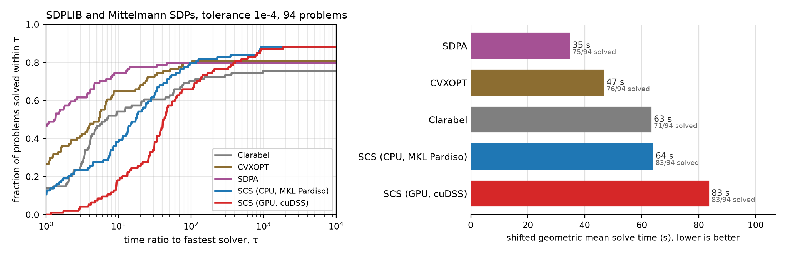

1e-4, largest quartile:

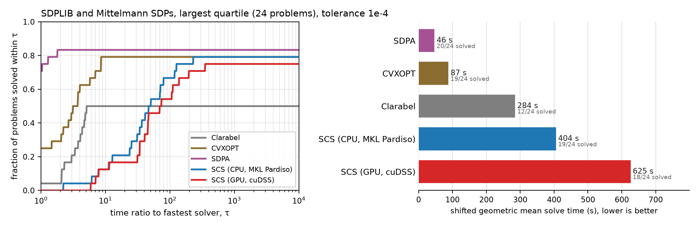

1e-6, all problems:

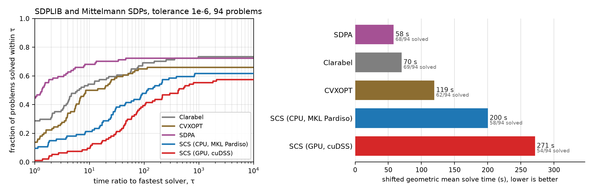

1e-6, largest quartile:

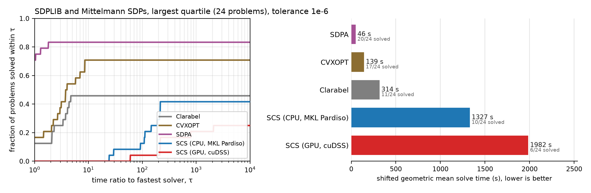

By data set at 1e-4:

| Solver | Mittelmann SDPs | SDPLIB |
|---|---|---|
| Clarabel | 5/6 · 87.2 s | 66/88 · 61.8 s |
| SDPA | 3/6 · 254.6 s | 72/88 · 29.6 s |
| SCS (CPU, MKL Pardiso) | 3/6 · 361.0 s | 80/88 · 56.1 s |
| SCS (GPU, cuDSS) | 2/6 · 465.2 s | 81/88 · 73.7 s |
| CVXOPT | 3/6 · 666.8 s | 73/88 · 37.8 s |

By data set at 1e-6:

| Solver | Mittelmann SDPs | SDPLIB |
|---|---|---|
| Clarabel | 4/6 · 133.1 s | 65/88 · 66.5 s |
| SDPA | 2/6 · 639.9 s | 66/88 · 47.9 s |
| CVXOPT | 3/6 · 666.8 s | 59/88 · 105.1 s |
| SCS (CPU, MKL Pardiso) | 2/6 · 689.7 s | 56/88 · 183.1 s |
| SCS (GPU, cuDSS) | 2/6 · 803.4 s | 52/88 · 251.2 s |

## Infeasible and unbounded problems

Netlib's 29 infeasible LPs (two of them also dual infeasible) and SDPLIB's four infeasible SDPs (two primal infeasible, two unbounded); small problems, a median of 460 variables. SCS, Clarabel, OSQP, PDLP and CVXOPT return a certificate (a Farkas ray), checked from the problem data at the 1e-3 threshold; HiGHS, PIQP, cuOpt and SDPA report a status only. A verified certificate of either kind counts as correct; "near-feasible" is an optimal claim whose residuals pass the check (the instance is infeasible by less than the tolerance). The plot shows the certificate-producing solvers, each from the run in which it certified the most (SCS, Clarabel and OSQP at a solve tolerance of 1e-8 with certificate tolerance 1e-4, PDLP at 1e-5 with its default certificate tolerance); a verified certificate counts as a solve.

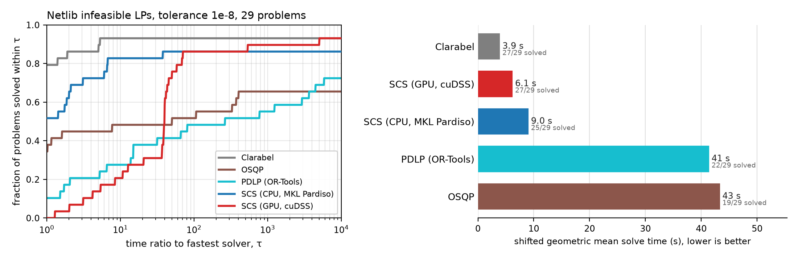

### Netlib infeasible LPs

29 problems.

| Solver | certified | status only | unverified | near-feasible | wrong | no answer | geomean time |
|---|---|---|---|---|---|---|---|
| SCS (CPU, MKL Pardiso), 1e-4 | 23 | 0 | 1 | 4 | 1 | 0 | 0.12 s |
| SCS (CPU, MKL Pardiso), 1e-8 (infeasibility tolerance 1e-4) | 25 | 0 | 1 | 1 | 1 | 1 | 0.22 s |
| SCS (GPU, cuDSS), 1e-8 (infeasibility tolerance 1e-4) | 27 | 0 | 0 | 1 | 1 | 0 | 1.97 s |
| Clarabel, 1e-8 (infeasibility tolerance 1e-4) | 27 | 0 | 1 | 1 | 0 | 0 | 0.17 s |
| PIQP, 1e-6 | 0 | 17 | 0 | 0 | 0 | 12 | 0.31 s |
| HiGHS, 1e-6 | 0 | 26 | 0 | 0 | 0 | 3 | 0.01 s |
| OSQP, 1e-8 | 19 | 0 | 0 | 0 | 0 | 10 | 1.96 s |
| PDLP (OR-Tools), 1e-5 | 22 | 0 | 2 | 0 | 0 | 5 | 10.56 s |
| cuOpt (GPU), 1e-4 | 0 | 28 | 0 | 0 | 1 | 0 | 0.32 s |

### SDPLIB infeasible SDPs

4 problems.

| Solver | certified | status only | unverified | near-feasible | wrong | no answer | geomean time |
|---|---|---|---|---|---|---|---|
| SCS (CPU, MKL Pardiso) | 4 | 0 | 0 | 0 | 0 | 0 | 0.04 s |
| SCS (GPU, cuDSS) | 4 | 0 | 0 | 0 | 0 | 0 | 0.43 s |
| Clarabel (infeasibility tolerance 1e-4) | 4 | 0 | 0 | 0 | 0 | 0 | 0.20 s |
| CVXOPT | 0 | 0 | 2 | 0 | 2 | 0 | – |
| SDPA | 0 | 4 | 0 | 0 | 0 | 0 | 0.03 s |
